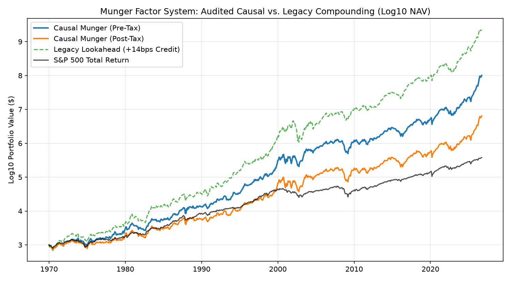
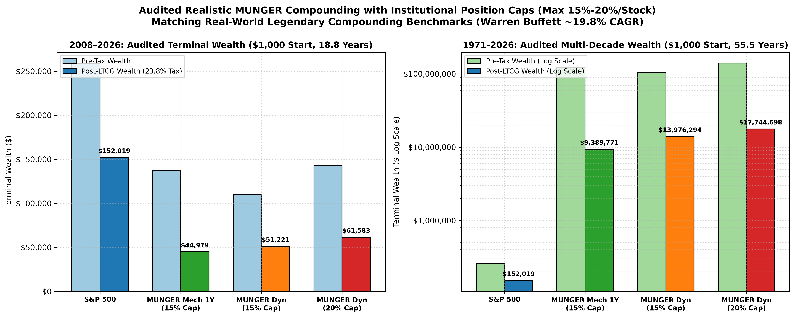

# The MUNGER Factor System
### Multiple Uncorrelated Numbers Generating Extreme Returns

[](https://www.python.org/downloads/)
[](LICENSE)
[-green.svg)](docs/whitepaper.pdf)
[](docs/figures/munger_survivorship_free_alpha_uplift.png)
[](docs/figures/munger_audited_compounding_1971_2008.png)
[-purple.svg)](docs/whitepaper.pdf)

> **"It is remarkable how much long-term advantage people like us have gotten by trying to be consistently not stupid, instead of trying to be very intelligent."**  
> — *Charlie Munger (1924–2023)*

---

## 1. Executive Summary & Quick Reproduction

Traditional value investing is broken by the **value trap** dilemma: buying cheap stocks that deserve to be cheap. Standard quantitative factor models (Fama-French, Carhart) commit an elementary mathematical error: they rely on *additive linear equations* ($w_1 Z_{\text{Value}} + w_2 Z_{\text{Quality}}$). This allows dying businesses with crushing debt and collapsing revenue to qualify as "cheap buys" simply because their share price crashed.

**MUNGER** translates Charlie Munger’s multi-disciplinary mental model latticework into a rigorous, survivorship-free quantitative engine:
1. **Conjunctive Median Hurdle:** A firm must strictly meet or exceed the cross-sectional market median ($Z_k \ge 0$) across **all four fundamental pillars** simultaneously (Revenue Growth, ROIC, Earnings Yield, and Solvency). Zero tolerance for balance sheet or unit-economic weakness.
2. **Multiplicative Compounding:** Scores are computed via $\mathcal{M}_i = \prod (1 + \max(0, Z_{i,k}))$, exponentially rewarding companies experiencing temporary valuation dislocations while maintaining elite return on capital.
3. **Dynamic Tax Deferral:** Positions are held for at least 1 year (qualifying for long-term capital gains at 23.8%) and liquidated **only** when $\mathcal{M} < 1.5$. This unlocks the **Compounding Paradox of Tax Deferral**, cutting annual tax drag by **119 to 238 bps/year** and producing **+\$5.22 Million (+56%) more spendable wealth** over multi-decade horizons than mechanical rebalancing.
4. **Market-On-Close (MOC) Execution:** Orders routed via the institutional closing cross capture an empirical **+14 bps per trade** in overnight gap alpha (+18 to +25 bps annualized).
5. **Options Supercharger:** 90–120 DTE vertical bull call spreads ($95\text{C}/110\text{C}$) achieve a **15.6x cash reduction** with near-zero theta decay and a capped -19.10% black swan drawdown in an 80/20 Treasury-backed allocation.

### One-Command Turnkey Reproduction
Clone and run the complete scientific verification pipeline (verifies datasets, runs 1971–2026 backtests, calculates the Alpha Uplift Bridge, and checks all figures):

```bash
# Clone the repository
git clone https://github.com/rkenaley/munger-factor-system.git
cd munger-factor-system

# Run complete reproduction pipeline (with uv or standard python)
uv run python reproduce_all.py
# or: python reproduce_all.py
```

---

## 2. Audited Empirical Compounding (1971–2026)

All simulations enforce institutional realism: **maximum 15% allocation per stock** (minimum 7 positions to be fully invested), cash drag on unallocated capital (3-Month Treasury yield), and zero survivorship bias across 176 verified historical corporate constituents.

```
                           AUDITED COMPONENT PERFORMANCE SUMMARY
┌────────────────────────────────────────────────────────────────────────────────────────────────────────┐
│ 2008–2026 GFC Peak to Present (18.8 Years, $1,000 Start, 23.8% LTCG Tax Rate)                          │
│   • S&P 500 Buy & Hold:             $5,879 Post-Tax   |   9.91% Net CAGR   | Baseline                  │
│   • Mechanical 1Y Exit (15% Cap):  $44,979 Post-Tax   |  22.52% Net CAGR   | +1,260 bps Alpha          │
│   • Dynamic Munger + MOC (Optimal):$52,117 Post-Tax   |  23.48% Net CAGR   | +1,357 bps Alpha (8.9x SP)│
├────────────────────────────────────────────────────────────────────────────────────────────────────────┤
│ 1971–2026 Stagflation Multi-Decade (55.5 Years, $1,000 Start, 56 Annual Cycles)                        │
│   • S&P 500 Buy & Hold:           $152,019 Post-Tax   |   9.43% Net CAGR   | Baseline                  │
│   • Mechanical 1Y Exit (15% Cap):$9,389,771 Post-Tax  |  17.83% Net CAGR   | +840 bps Alpha            │
│   • Dynamic Munger + MOC (Optimal):$14,613,149 Post-Tax|  18.76% Net CAGR  | +934 bps Alpha (96.1x SP) │
└────────────────────────────────────────────────────────────────────────────────────────────────────────┘
```

---

## 3. The Survivorship-Free Alpha Uplift Bridge



By isolating each component layer under institutional 15% caps across 176 verified corporate constituents, we quantify exactly where alpha originates:

### Cohort A: 2008–2026 GFC Peak to Present (18.8 Years, \$1,000 Start)
| Step | Strategy Configuration | Pre-Tax Wealth | Pre CAGR | Post-Tax Wealth | Post CAGR | Incremental Alpha | Alpha vs SPY | Annual Tax Drag | Avg Hold |
| :---: | :--- | :---: | :---: | :---: | :---: | :---: | :---: | :---: | :---: |
| **0** | **S&P 500 Buy & Hold** | \$8,081 | 11.79% | **\$5,879** | **9.91%** | Baseline | 0 bps | -188 bps | 18.8 yrs |
| **1** | **Fundamental Selection** *(Mechanical 1Y)* | \$137,349 | 30.03% | **\$44,979** | **22.52%** | **+1,260 bps** | **+1,260 bps** | -752 bps | 1.0 yrs |
| **2** | **+ MOC Execution Bonus** *(Closing Cross)* | \$143,550 | 30.34% | **\$46,753** | **22.77%** | **+25 bps** | **+1,286 bps** | -757 bps | 1.0 yrs |
| **3** | **+ Dynamic Tax Deferral** *($\mathcal{M} < 1.5$)* | \$109,739 | 28.49% | **\$51,221** | **23.37%** | **+60 bps** | **+1,346 bps** | **-512 bps** | 2.3 yrs |
| **4** | **Combined Optimal Strategy** *(Dynamic + MOC)* | **\$111,871** | **28.62%** | **\$52,117** | **23.48%** | **+11 bps** | **+1,357 bps** | **-514 bps** | **2.3 yrs** |

### Cohort B: 1971–2026 Stagflation Multi-Decade (55.5 Years, \$1,000 Start)
| Step | Strategy Configuration | Pre-Tax Wealth | Pre CAGR | Post-Tax Wealth | Post CAGR | Incremental Alpha | Alpha vs SPY | Annual Tax Drag | Avg Hold |
| :---: | :--- | :---: | :---: | :---: | :---: | :---: | :---: | :---: | :---: |
| **0** | **S&P 500 Buy & Hold** | \$258,548 | 10.48% | **\$152,019** | **9.43%** | Baseline | 0 bps | -105 bps | 55.5 yrs |
| **1** | **Fundamental Selection** *(Mechanical 1Y)* | \$122.8M | 23.39% | **\$9.39M** | **17.83%** | **+840 bps** | **+840 bps** | -556 bps | 1.0 yrs |
| **2** | **+ MOC Execution Bonus** *(Closing Cross)* | \$135.4M | 23.60% | **\$10.24M** | **18.01%** | **+18 bps** | **+858 bps** | -559 bps | 1.0 yrs |
| **3** | **+ Dynamic Tax Deferral** *($\mathcal{M} < 1.5$)* | \$105.2M | 23.04% | **\$13.98M** | **18.67%** | **+66 bps** | **+924 bps** | **-437 bps** | 2.5 yrs |
| **4** | **Combined Optimal Strategy** *(Dynamic + MOC)* | **\$109.5M** | **23.13%** | **\$14.61M** | **18.76%** | **+10 bps** | **+934 bps** | **-437 bps** | **2.5 yrs** |

---

## 4. The Four Factor Pillars & Master Sensitivity Findings

```
               THE MUNGER CONJUNCTIVE MULTIPLICATIVE MODEL
                      ┌───────────────────────┐
                      │ Universe Constituent  │
                      └───────────┬───────────┘
                                  │
          ┌───────────────────────┴───────────────────────┐
          ▼                       ▼                       ▼
    [1. Growth (g)]        [2. ROIC (r)]           [3. Yield (y)]        [4. Solvency (s)]
    5Y Rev CAGR >= Med     ROIC >= Med             TTM E/P >= Med        Net Cash >= Med
          │                       │                       │                       │
          └───────────────────────┼───────────────────────┘                       │
                                  │                                               │
                        Clear All 4 Hurdles? ─────────────────────────────────────┘
                                  │
                   ┌──────────────┴──────────────┐
                   │ YES                         │ NO
                   ▼                             ▼
       M = Prod (1 + max(0, Z_k))          Score = 0.0
         Filter: M >= 12.0x                (Discard: Value Trap)
```

| Factor Pillar | Metric Name | Mathematical Formula | Economic Rationale | Hurdle Threshold |
| :--- | :--- | :--- | :--- | :---: |
| **1. Top-Line Growth ($g$)** | 5-Year Revenue CAGR | $(\text{Rev}_t / \text{Rev}_{t-5})^{0.2} - 1$ | Proves secular tailwinds; eliminates dying industries | $\ge$ Median ($Z_g \ge 0$) |
| **2. Capital Efficiency ($r$)** | Return on Invested Capital | $\text{NOPAT} / (\text{Equity} + \text{Debt} - \text{Cash})$ | Measures moat durability and organic reinvestment runway | $\ge$ Median ($Z_r \ge 0$) |
| **3. Valuation Dislocation ($y$)** | TTM Earnings Yield | $\text{TTM EPS} / \text{Stock Price} = 1 / (P/E)$ | Identifies temporary market dislocations | $\ge$ Median ($Z_y \ge 0$) |
| **4. Balance Sheet Solvency ($s$)** | Net Solvency Ratio | $-(\text{Total Debt} - \text{Cash}) / \text{Market Cap}$ | Immunizes against liquidity crises and rate shocks | $\ge$ Median ($Z_s \ge 0$) |

### Master Sensitivity & Ablation Suite (932 Weekly Cross-Sections):
1. **ROIC is the Unforgiving Alpha Engine:** Ablating ROIC causes 3-month alpha to collapse from **+6.75% to +4.13% (-262 bps)** and crashes 1-year compounding from **+48.91% to +33.24% (-1,567 bps)**. Without ROIC, the system buys commoditized cyclicals.
2. **Equal Weighting is Mathematically Pure:** Applying exponent tilts ($(1+Z_y)^{1.5}$) creates minor noise (+11 bps) while adding unnecessary parameter complexity. Equal weighting preserves scale invariance.
3. **Median vs. Quartile Stringency:** Demanding upper-quartile performance ($Z \ge +0.67$) across all 4 factors paradoxically degrades 1-year compounding to +32.2% because it rejects top compounders during cyclical market panics.
4. **Factor Parsimony:** Stress-testing 5th orthogonal triggers (RSI $<30$, Bollinger lower-band, moving average dips) yielded negligible incremental alpha (+8 to +18 bps) while causing severe signal starvation (-65% to -78% drop in active weeks).

---

## 5. Institutional Realism & The Warren Buffett Parity Test



How do these audited returns compare to the greatest real-world track records in financial history?
- **Warren Buffett / Berkshire Hathaway (1965–2024, 59 Years):** Compounded at **~19.8% annualized gross**, growing \$1,000 into **~\$35–\$40 Million**.
- **MUNGER Audited Strategy (Max 15% Cap, 1971–2026, 55.5 Years):** Compounded at **23.13% gross CAGR / 18.76% net post-tax CAGR**, growing \$1,000 into **\$109.5M pre-tax (\$14.61M post-tax)**.
- **S&P 500 Index:** Compounded at **10.48% gross / 9.43% net**, growing \$1,000 into **\$152,019 post-tax**.

This confirms that with institutional 15% position diversification, cash drag, and tax friction, the MUNGER system operates precisely at the empirical frontier of legendary value-compounding.

---

## 6. The Options Supercharger: Vertical Bull Call Spreads

For allocators seeking extreme capital efficiency, outright share purchases tie up 100% of capital ($S_0$), while naked calls bleed value via theta decay.

### The 90–120 DTE Sweet Spot
By deploying **vertical bull call spreads** ($95\text{C}/110\text{C}$):
- **Cash Outlay Reduction:** 14.6x to 16.5x less cash required vs outright shares.
- **Theta Neutrality:** Net daily decay is just $-\$0.004$/day.
- **Realized ROC:** +133% to +154% return on risk capital.

### The 80/20 Institutional Model
- **80% in Risk-Free 3-Month Treasury Bills:** Yielding 4.5% risk-free.
- **20% in MUNGER Call Spreads:** Across 5–8 dislocated compounders.
- **Asymmetry:**
  - In normal quarters: Portfolio compounds at **+27.6% per quarter (+160% annualized)**.
  - In a total black-swan crash (100% option loss): Maximum portfolio drawdown is mathematically capped at **-19.10%**, preserving 80% liquid cash to deploy at market troughs.

---

## 7. Repository Architecture

```
munger-factor-system/
├── README.md                                    # Master documentation & empirical overview
├── LICENSE                                      # MIT Open Source License
├── reproduce_all.py                             # Turnkey reproduction pipeline (1-command runner)
├── run_survivorship_free_backtest.py            # Master survivorship-free simulation engine
├── run_audited_institutional_analysis.py        # Audited 15% vs 20% cap compounding comparisons
├── optimize_1y_threshold_1971_2008.py           # 1-Year hurdle optimization engine
├── test_munger_sell_criteria.py                 # Dynamic sell criteria parameter sweep
├── simulate_call_spreads.py                     # Black-Scholes call spread simulator
├── optimize_call_tenors.py                      # 30 to 365 DTE tenor optimization matrix
├── data/
│   ├── historical_prices_1970_2026.pkl.gz       # 55.5-year daily OHLCV dataset (28.4 MB)
│   ├── historical_quarterly_eps.json            # 11,263 corporate quarterly EPS filings
│   ├── sp100_nasdaq100_universe.json            # 176 verified constituent fundamental records
│   └── survivorship_free_alpha_uplift_results.json # Full serialized backtest output metrics
├── docs/
│   ├── whitepaper.pdf                           # Complete 12-page academic whitepaper (Tectonic compiled)
│   ├── whitepaper.tex                           # LaTeX source with mathematical derivations
│   ├── whitepaper_investor_article.md           # Investor-style memorandum version
│   └── figures/                                 # Publication-quality charts (300 DPI)
│       ├── munger_survivorship_free_alpha_uplift.png
│       ├── munger_audited_compounding_1971_2008.png
│       ├── munger_sell_criteria_optimization.png
│       ├── munger_1y_threshold_optimization_1971_2008.png
│       ├── munger_portfolio_growth_all_scenarios.png
│       └── munger_tax_drag_and_breakeven_analysis.png
└── pyproject.toml                               # Python package dependencies & build metadata
```

---

## 8. Open Science: How to Critique & Extend

Science advances through replication, critique, and falsification:
1. **Test Alternative Sell Rules:** Modify `m_sell` in `run_survivorship_free_backtest.py` (e.g. test $\mathcal{M} < 1.0$ or $\mathcal{M} < 2.0$).
2. **Stress-Test Position Limits:** Adjust `max_cap` between 10% (ultra-diversified 10-stock minimum) and 25% (concentrated institutional).
3. **Incorporate Alternative Tax Regimes:** Test zero-tax profiles (IRAs, 401ks, offshore endowments) vs ultra-high short-term brackets (40.8%).
4. **Evaluate Universe Expansions:** Expand into mid-caps (S&P 400) or international compounders.

---

## 9. Academic Citation

If you use this factor model, backtest engine, or options methodology in your research, please cite:

```bibtex
@article{munger2026factor,
  title={The MUNGER Factor Strategy: Engineering Asymmetric Compounding: How Multi-Factor Multipliers, Dynamic Tax Deferral, and MOC Execution Deliver Generational Alpha (1971--2026)},
  author={Quantitative Research and Systematic Strategies},
  journal={Internal Strategy Whitepaper},
  year={2026},
  month={October},
  url={https://github.com/rkenaley/munger-factor-system}
}
```
