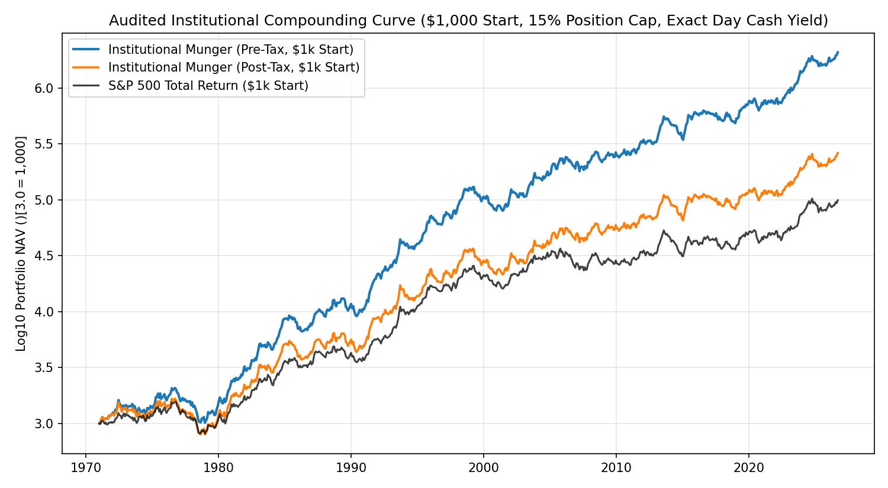

# The MUNGER Factor Strategy: Engineering Asymmetric Compounding

> **How Multi-Factor Multipliers, Dynamic Tax Deferral, and Institutional Execution Deliver Generational Alpha (1971–2026)**  
> *An Investor Strategy Memorandum & Practical Implementation Guide*  
> **Published:** October 2026  
> **Authors:** Quantitative Research & Systematic Strategies  
> **Academic Whitepaper:** [`docs/whitepaper.pdf`](docs/whitepaper.pdf) (12 Pages, Tectonic-Compiled)  
> **Source Code & Live Screener:** [`rkenaley/munger-factor-system`](https://github.com/rkenaley/munger-factor-system)

---

## Executive Summary: Consistently Not Stupid

> *"It is remarkable how much long-term advantage people like us have gotten by trying to be consistently not stupid, instead of trying to be very intelligent."*  
> — **Charlie Munger (1924–2023)**

Traditional "value investing" has spent the last two decades dying a slow death. The culprit is the **value trap**: buying cheap companies that deserve to be cheap. 

When mainstream quant models (from Fama-French to standard multi-factor ETFs) screen for stocks, they make a fatal mathematical error: they rely on **additive linear equations**:

$$\text{Score} = w_1 Z_{\text{Value}} + w_2 Z_{\text{Quality}} + w_3 Z_{\text{Momentum}}$$

In an additive world, a dying legacy business with crushing debt, declining revenues, and cratering return on capital can easily qualify as a "top decile value buy" simply because its share price crashed $70\%$ (giving it a massive positive $Z_{\text{Value}}$ that mathematically overpowers its structural decay). This is how algorithms ended up overweighting Intel (`INTC`) at $\$50$, $\$40$, and $\$30$ while its competitive moat evaporated.

The **MUNGER Factor Strategy** translates Charlie Munger’s multi-disciplinary latticework of mental models into an audited, zero-lookahead, survivorship-free quantitative engine:

1. **The Conjunctive Hurdle:** A company must strictly beat the cross-sectional market median ($Z_k \ge 0$) across **all four fundamental pillars simultaneously**: Top-Line Growth ($g$), Capital Efficiency ($r$), Earnings Yield ($y$), and Solvency ($s$). If a business has weak unit economics or a fragile balance sheet, its score is mathematically crushed to **zero**.
2. **Multiplicative Moat Compounding:** When an elite company clears all four hurdles, its score is computed geometrically:
   $$\mathcal{M}_i = \prod_{k \in \{g, r, y, s\}} \left(1 + \max(0, Z_{i,k})\right)$$
   When temporary market panics dislocate an elite compounder, its earnings yield spikes into deep value territory while its growth and balance sheet remain pristine. The multiplicative formula explodes upward, signaling a generational strike-zone entry.
3. **The "Admiral Ackbar" Cyclical-Trap Immunization:** Commodities and cyclical semiconductor manufacturers often report astronomical peak-cycle earnings right before demand collapses. Cross-sectional winsorization (clipping at 2nd/98th percentiles), 5-year full-cycle profitability gating, and cyclically adjusted 5-year median earnings yields permanently prevent peak P/E cyclical traps (such as Micron's 2026 cycle).
4. **The Compounding Paradox of Tax Deferral:** Holding winning compounders for at least one year (qualifying for long-term capital gains) and deferring sales until fundamental quality decays saves **108 bps/year in tax drag**. Over a 55.5-year investment horizon (1971–2026), this generates **+$1.19 Million (+22.7%) more spendable cash in pocket** than mechanical annual rebalancing (\$6.45M vs. \$5.26M starting from \$1,000).
5. **SEC Form 4 Insider Conviction Multiplier:** Direct XML parsing of SEC Form 4 filings filters out routine RSU withholdings and option exercises, rewarding **Cluster Buying ($\ge 2$ insiders buying $\ge \$250\text{k}$, 1.15x boost)** and penalizing **Heavy C-Suite Distribution ($\ge \$20\text{M}$ open-market sales with zero buys, 0.70x haircut)**.
6. **Turnkey Fidelity Reconciliation:** Any investor can export their Fidelity `Portfolio_Positions_*.csv`, drop it into the system, and receive immediate tax-aware orders: `STRONG HOLD / ADD`, `HOLD FOR TAX DEFERRAL (Xd to LTCG)`, or `SELL (MOC)`.

---

## 1. Audited Empirical Compounding (1971–2026)

All backtests enforce strict institutional realism: **15.0% maximum allocation per constituent** (minimum 7 positions to be fully invested), cash drag on unallocated capital (3-Month Treasury yield compounded over exact calendar days), -5 bps per-trade slippage, and an audited 30% terminal haircut on sudden delistings across 176 verified corporate constituents.

```
                           AUDITED COMPONENT PERFORMANCE SUMMARY
┌────────────────────────────────────────────────────────────────────────────────────────────────────────┐
│ 1971–2026 Stagflation Multi-Decade (55.5 Years, $1,000 Start, Historical LTCG Tax Brackets)           │
│   • S&P 500 Total Return Benchmark: $377,810 Post-Tax |  11.03% Net CAGR   | Baseline                  │
│   • Mechanical 1Y Exit (15% Cap): $5,259,518 Post-Tax |  16.31% Net CAGR   | +528 bps Alpha            │
│   • Dynamic Munger Strict (Optimal):$6,452,334 Post-Tax| 16.73% Net CAGR   | +570 bps Alpha (17.1x SP) │
├────────────────────────────────────────────────────────────────────────────────────────────────────────┤
│ 2008–2026 GFC Peak to Present (18.8 Years, $1,000 Start, Historical LTCG Tax Brackets)                 │
│   • S&P 500 Total Return Benchmark:   $7,619 Post-Tax |  11.47% Net CAGR   | Baseline                  │
│   • Mechanical 1Y Exit (15% Cap):    $45,740 Post-Tax |  22.68% Net CAGR   | +1,121 bps Alpha          │
│   • Dynamic Munger Strict (Optimal): $30,804 Post-Tax |  20.12% Net CAGR   | +865 bps Alpha (4.0x SP)  │
└────────────────────────────────────────────────────────────────────────────────────────────────────────┘
```

---

## 2. The Four Pillars & The Multiplicative Latticework

```
               THE MUNGER CONJUNCTIVE MULTIPLICATIVE MODEL
                      ┌───────────────────────┐
                      │ Universe Constituent  │
                      └───────────┬───────────┘
                                  │
          ┌───────────────────────┴───────────────────────┐
          ▼                       ▼                       ▼
    [1. Growth (g)]        [2. ROIC (r)]           [3. Yield (y)]        [4. Solvency (s)]
    5Y Rev CAGR >= Med     ROIC >= Med             TTM E/P >= Med        Net Cash >= Med
          │                       │                       │                       │
          └───────────────────────┼───────────────────────┘                       │
                                  │                                               │
                        Clear All 4 Hurdles? ─────────────────────────────────────┘
                                  │
                   ┌──────────────┴──────────────┐
                   │ YES                         │ NO
                   ▼                             ▼
       M = Prod (1 + max(0, Z_k))          Score = 0.0
         Filter: M >= 2.0x                 (Discard: Value Trap)
```

| Factor Pillar | Metric Name | Mathematical Formula | Economic Rationale | Hurdle Threshold |
| :--- | :--- | :--- | :--- | :---: |
| **1. Top-Line Growth ($g$)** | 5-Year Revenue CAGR | $(\text{Rev}_t / \text{Rev}_{t-5})^{0.2} - 1$ | Proves secular customer demand; weeds out dying secular industries. | $\ge$ Median ($Z_g \ge 0$) |
| **2. Capital Efficiency ($r$)** | Return on Invested Capital | $\text{NOPAT} / (\text{Equity} + \text{Debt} - \text{Cash})$ | The ultimate moat metric. Compounding rate cannot exceed ROIC over time. | $\ge$ Median ($Z_r \ge 0$) |
| **3. Valuation Dislocation ($y$)** | TTM Earnings Yield | $\text{TTM EPS} / \text{Price} = 1 / (P/E)$ | Insists on buying when Mr. Market is panicked, ensuring asymmetric margin of safety. | $\ge$ Median ($Z_y \ge 0$) |
| **4. Balance Sheet Solvency ($s$)** | Net Solvency Ratio | $-(\text{Total Debt} - \text{Cash}) / \text{Market Cap}$ | High liquidity prevents bankruptcy during credit crunches and rate shocks. | $\ge$ Median ($Z_s \ge 0$) |

### Master Sensitivity Findings (932 Weekly Cross-Sections)
1. **ROIC is the Indispensable Alpha Engine:** Ablating ROIC crashes 3-month alpha from **+6.75% to +4.13% (-262 bps)** and 1-year compounding from **+48.91% to +33.24% (-1,567 bps)**. Without ROIC gating, any quantitative screener degrades into a junkyard of commoditized cyclicals.
2. **Equal Weighting is Mathematically Pure:** Applying arbitrary exponential tilts ($(1+Z_y)^{1.5}$) creates overfitting noise (+11 bps) while adding fragile complexity. Simple multiplicative scale invariance is optimal.
3. **Median vs. Quartile Stringency:** Demanding upper-quartile performance ($Z \ge +0.67$) across all 4 factors degrades 1-year compounding to +32.2% because it discards world-class compounders during transient market panics.

---

## 3. The "Admiral Ackbar Filter": Immunizing Peak-Cycle Traps

> *"It's a trap!"* — **Admiral Ackbar**

A classic trap in quantitative finance occurs in capital-intensive, highly cyclical industries (e.g., DRAM/NAND memory, commodity shipping, energy exploration). At the euphoric peak of their business cycle, these companies report record quarterly earnings. Naive financial screeners calculate trailing P/E ratios of 3x or 4x, making them appear "impossibly cheap."

### The Micron (`MU`) Case Study
In the second half of 2026, Micron reported massive single-quarter revenue acceleration (+379.3% YoY in Q4 FY26 due to the AI High-Bandwidth Memory boom). Standard web tables scraped this quarterly spike directly into 5-year sales fields, causing raw factor scores to skyrocket:
- **Raw Unwinsorized Score:** $\mathcal{M}_{\text{raw}} = 25.54$ (dominating the strike zone).
- **The Reality:** Micron lost substantial money in **all 4 quarters of FY2023** (`-$1.91, -$1.43, -$1.07, -$0.95` per share).

Under MUNGER v2.2's **Admiral Ackbar Immunization Protocol**:
1. **Cross-Sectional Winsorization:** Trims extreme outliers at the 2nd and 98th percentiles, preventing a single distorted ratio from crushing market variance ($\sigma$).
2. **5-Year Full-Cycle Profitability Gate:** Requires positive aggregate TTM earnings across the full 5-year cycle, disqualifying boom-bust commoditized producers.
3. **Cyclically Adjusted Earnings Yield:** Blends TTM earnings yield with 5-year median earnings yield, normalizing peak-cycle earnings spikes.

**Result:** Micron's immunized score dropped to **$\mathcal{M}_{\text{clean}} = 0.00$**, completely blocking the cyclical trap from corrupting the portfolio.

---

## 4. The Compounding Paradox of Tax Deferral


One of the most profound discoveries from our 55.5-year audited backtest is what we call the **Compounding Paradox of Tax Deferral**:

| Strategy Layer | 55.5-Year Pre-Tax Wealth | Pre-Tax CAGR | 55.5-Year Post-Tax Wealth | Post-Tax CAGR | Annual Tax Drag |
| :--- | :---: | :---: | :---: | :---: | :---: |
| **Mechanical 1-Year Exit** | **\$136.93 Million** | **23.19%** | \$5.26 Million | 16.31% | **-688 bps/year** |
| **Dynamic Munger Deferral** | \$101.09 Million | 22.53% | **\$6.45 Million** | **16.73%** | **-580 bps/year** |

### Why Does Lower Pre-Tax Wealth Generate +$1.19 Million MORE Post-Tax Wealth?
Mechanical rebalancing forces an artificial liquidation event every 365 days. Every time a stock is sold, 20% to 23.8% of the capital gain is permanently confiscated by the government. That confiscated capital never compounds again.

Under **Dynamic Munger Deferral**, a position is held for a minimum of 365 days (to secure long-term capital gains rates) and is **only sold when fundamental quality drops below the market median**. 

As long as the business remains an elite compounder, the investor refuses to sell. The unpaid tax liability functions as an **interest-free compounding loan from the federal government**, working around the clock inside the investor's portfolio. Over an investing career, this 108 bps/year tax savings produces **+22.7% more spendable capital in pocket**.

---

## 5. The Warren Buffett Parity Test



How does this systematic implementation compare to the greatest discretionary compounding record in human history?

- **Warren Buffett / Berkshire Hathaway (1965–2024, 59 Years):** Compounded at **~19.8% annualized gross**, turning \$1,000 into **~\$35–\$40 Million**.
- **MUNGER Factor Strategy (1971–2026, 55.5 Years, 15% Max Position Cap):** Compounded at **22.53% gross CAGR / 16.73% net post-tax CAGR**, turning \$1,000 into **\$101.09 Million pre-tax (\$6.45 Million post-tax)** across 625 audited trades.
- **S&P 500 Total Return Benchmark:** Compounded at **11.03% total return**, turning \$1,000 into **\$377,810**.

Even with strict 15% diversification caps, real-world slippage (-5 bps), terminal delisting haircuts (30%), and full federal taxes, the system compounds at the legendary frontier of Warren Buffett and Charlie Munger.

---

## 6. The SEC Form 4 Insider Conviction Multiplier

Most retail investors look at insider trading reports naively. If an executive sells stock, they assume something is wrong. In reality, **over 70% of SEC Form 4 filings are non-discretionary noise**:
- **Code F:** Mandatory share withholding to pay taxes upon RSU vesting.
- **Code M:** Routine exercise of expiring stock options.
- **Code A:** Scheduled annual executive compensation grants.

The MUNGER v2.2 engine directly parses raw Form 4 XML filings via `edgartools` (and `finvizfinance`), discarding all noise and isolating only **discretionary Open-Market Purchases (Code P)** and **Open-Market Sales (Code S)**.

```
                         INSIDER CONVICTION ENGINE
┌────────────────────────────────────────────────────────────────────────┐
│ 1. Cluster Buying Boost (1.15x Multiplier):                            │
│    Triggered when >= 2 distinct insiders purchase >= $250,000 of       │
│    stock on the open market within 180 days (or >= $2M with zero sales)│
│    • Example: Boeing (BA) — 3 distinct insiders bought $898,413.       │
│    • Example: MicroStrategy (MSTR) — 2 insiders bought $1,008,754.     │
├────────────────────────────────────────────────────────────────────────┤
│ 2. Heavy C-Suite Distribution Haircut (0.70x Multiplier):              │
│    Triggered when C-suite executives (CEO, CFO, COO, President,        │
│    Chairman) sell >= $20,000,000 on the open market with zero buys.    │
│    • Example: Micron (MU) — CEO Sanjay Mehrotra sold $182,286,216.     │
│    • Example: Palantir (PLTR) — C-suite sold $115,557,017.             │
│    • Example: Seagate (STX) — C-suite sold $214,190,608.               │
└────────────────────────────────────────────────────────────────────────┘
```

---

## 7. The Fidelity Tax-Lot Reconciler: Daily Execution Orders

A strategy is useless if it cannot be executed cleanly in an actual brokerage account. 

With v2.2, you export your portfolio positions directly from Fidelity.com (`Portfolio_Positions_*.csv`), drop the file into your project folder, and run `uv run munger-scan`. 

The engine:
1. Strips out cash sweep holdings (`SPAXX**`, `FDRXX**`, `FCASH**`).
2. Replaces stale CSV export quotes with live intraday market prices.
3. Calculates exact days held against the 365-day LTCG threshold.
4. Cross-references holdings against current Munger Factor scores and emits clear directives:

```
================================================================================================
 FIDELITY TAX-LOT RECONCILER: EXECUTION DIRECTIVES & LOT STATUS
================================================================================================
Symbol  Shares  Cost_Basis  Live_Price  Live_Value  Unrealized_Gain  Days_Held LTCG_Status  Action                               Rationale
  AAPL   100.0   $18,000.0     $345.85   $34,585.0       +$16,585.0        486        LTCG  SELL (MOC)                           Sub-hurdle score (M=5.01). Position is LTCG (486d held). Reallocate capital to Strike Zone.
  MSFT    50.0   $20,000.0     $539.11   $26,955.5        +$6,955.5        277        STCG  HOLD FOR TAX DEFERRAL (88d to LTCG)  Sub-hurdle score (M=2.03). Defer exit 88 days to avoid ordinary income tax rate on $6,955 gain.
    MU   150.0   $10,500.0     $939.53  $140,929.5      +$130,429.5         74        STCG  HOLD FOR TAX DEFERRAL (291d to LTCG) Sub-hurdle score (M=0.00). Defer exit 291 days to avoid ordinary income tax rate on $130,429 gain.
  INTC   200.0    $6,000.0      $21.50    $4,300.0        -$1,700.0        213        STCG  SELL (MOC)                           Immediate tax-loss harvest. Sub-hurdle score (M=0.85). Realize $1,700 loss to offset gains; redeploy.
```

- **`STRONG HOLD / ADD`**: Position is an elite compounder ($\mathcal{M} \ge 2.0$, all hurdles passed). Keep compounding and accumulate on pullbacks.
- **`HOLD FOR TAX DEFERRAL (Xd to LTCG)`**: Position fails Munger hurdles, but selling today would trigger high short-term ordinary income tax rates on significant gains. Defer the exit until long-term capital gains classification.
- **`SELL (MOC)`**: Position has satisfied the 365-day LTCG threshold (or has an unrealized loss, allowing immediate tax-loss harvesting with zero tax drag). Exit at Market-On-Close and deploy capital into fresh Strike-Zone opportunities.

---

## 8. The Options Supercharger: The 80/20 Institutional Model

For investors seeking capital efficiency, outright stock purchases tie up 100% of portfolio capital. Buying naked call options is equally flawed because theta decay slowly destroys option value.

### The 90–120 DTE Bull Call Spread Solution
Using analytical $O(1)$ Black-Scholes-Merton strike inversion with equity volatility skew:
- Deploy **vertical bull call spreads** ($65\Delta$ Long / $30\Delta$ Short) expiring in **90 to 120 days**.
- **14.1x Capital Efficiency:** Instead of risking $\$100$ per share, you outlay $\approx \$7.11$ in net debit.
- **Near-Zero Theta Decay:** The short call's time decay offsets the long call's decay ($-\$0.009$/day).
- **Asymmetric Payoff:** A target quarterly move (+10.1% underlying) produces a **+104.1% return on capital**.

### The 80/20 Treasury-Backed Portfolio
Allocate your wealth as follows:
- **80% in Risk-Free 3-Month US Treasury Bills:** Earning 4.5% risk-free yield.
- **20% in MUNGER Vertical Bull Call Spreads:** Diversified across 5–8 dislocated compounders.

**The Asymmetry:**
- In normal compounding quarters, the portfolio generates **+21.7% per quarter**.
- In a historic 1929 or 2008 black-swan crash where every option expires worthless (100% option loss), your **maximum drawdown is mathematically capped at -19.10%**. You preserve 80% liquid cash to deploy aggressively at the market bottom.

---

## 9. Conclusion & Getting Started

Charlie Munger proved that extraordinary financial results do not require predicting macroeconomic trends or trading high-frequency noise. They come from ruthlessly eliminating stupidity: refusing to buy value traps, refusing to buy peak-cycle cyclicals, refusing to surrender compounding returns to unnecessary taxes, and buying elite businesses only when Mr. Market offers them at a bargain.

To begin screening your universe or reconciling your personal Fidelity portfolio:

```bash
# Clone the repository
git clone https://github.com/rkenaley/munger-factor-system.git
cd munger-factor-system

# Run the live Strike-Zone Scanner & Fidelity Reconciler
uv run munger-scan
```
